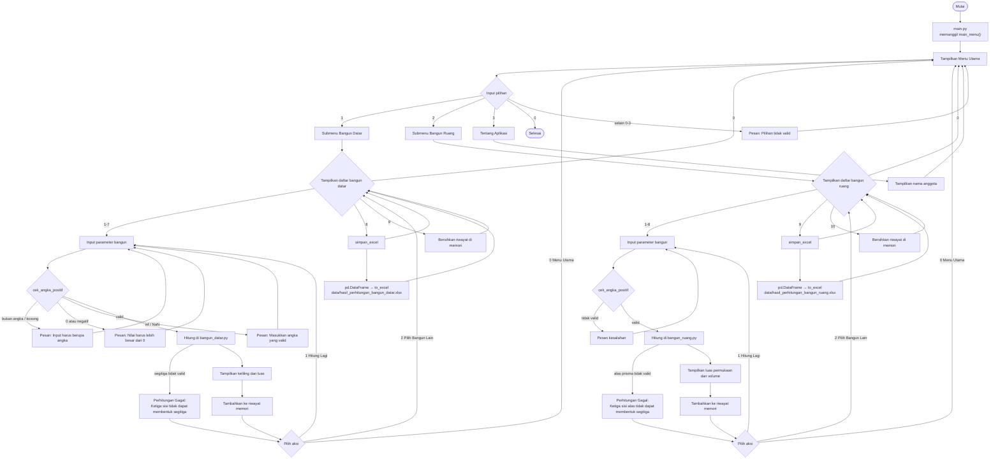
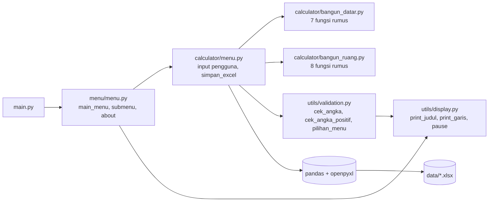

# Bagan Alur Sistem (Bahan untuk 3.2 Kerangka Kerja)

File ini berisi bagan siap pakai untuk laporan. Diagram ditulis dengan sintaks Mermaid,
sehingga bisa langsung dirender menjadi gambar.

**Cara membuat gambar untuk laporan (pilih satu):**

1. Buka <https://mermaid.live>, tempel isi blok kode di bawah, klik **Actions → PNG**.
2. Atau gambar ulang di <https://app.diagrams.net> (draw.io) mengikuti alur yang sama.
3. Atau minta anggota yang biasa membuat diagram mengikuti daftar tahap pada bagian
   "Penjelasan Tahap" — alurnya sudah pasti, tidak perlu menebak.

Simpan hasilnya sebagai `gambar/bagan-alur.png` dan `gambar/struktur-modul.png`.

---

## 1. Bagan Alur Utama (Flowchart)

## 2. Bagan Struktur Modul (Dependency)

## 3. Penjelasan Tahap (untuk naskah 3.2)

Tulis satu paragraf pendek per tahap, mengikuti urutan ini:

| Tahap | Penjelasan yang bisa dipakai |
|---|---|
| 1. Inisialisasi | `main.py` menjadi titik masuk aplikasi. Fungsi `main()` memanggil `main_menu()` dari modul `menu/menu.py`, sehingga seluruh alur program terpusat pada satu pintu masuk. |
| 2. Menu utama | Menampilkan empat pilihan: kalkulator bangun datar, kalkulator bangun ruang, tentang aplikasi, dan keluar. Input divalidasi oleh `pilihan_menu()` agar hanya nilai yang terdaftar yang diterima. |
| 3. Submenu bangun datar | Menampilkan tujuh bangun datar ditambah opsi simpan ke Excel, bersihkan riwayat, dan kembali. Riwayat disimpan pada list `riwayat_perhitungan` di dalam fungsi ini. |
| 4. Input parameter | Setiap bangun meminta parameter sesuai kebutuhannya (contoh: persegi hanya sisi; trapesium meminta empat sisi dan tinggi). Semua input melewati `cek_angka_positif()` untuk menolak nilai bukan angka, nol, negatif, dan tak hingga. |
| 5. Perhitungan | Perhitungan dipisahkan dari tampilan: fungsi murni di `bangun_datar.py` dan `bangun_ruang.py` menerima parameter dan mengembalikan hasil. Pemisahan ini memudahkan pengujian dan penambahan bangun baru. |
| 6. Validasi geometri | Khusus segitiga dan prisma segitiga, program memeriksa ketidaksamaan segitiga sebelum menghitung. Bila gagal, fungsi melempar `ValueError` yang ditangkap di `calculator/menu.py` dan ditampilkan sebagai pesan kesalahan. |
| 7. Penampilan hasil | Hasil ditampilkan dengan format dua angka desimal beserta satuan cm, cm², atau cm³, lalu baris data ditambahkan ke riwayat agar bisa disimpan. |
| 8. Navigasi aksi | Setelah hasil tampil, pengguna memilih hitung lagi, pilih bangun lain, atau kembali ke menu utama. Struktur perulangan bersarang inilah yang menjaga aplikasi tetap berjalan tanpa restart. |
| 9. Penyimpanan | `simpan_excel()` mengubah list riwayat menjadi `DataFrame` pandas lalu menuliskannya dengan `to_excel()` (engine openpyxl) ke folder `data/`. |

## 4. Catatan Kejujuran untuk 3.2

Saat menjelaskan tahap 4 dan 9, jangan menulis klaim berikut karena tidak sesuai kode:

- "Riwayat tersimpan permanen di database" → **salah**, riwayat hanya ada di memori sesi berjalan.
- "Bersihkan Excel menghapus file" → **salah**, hanya mengosongkan list di memori.
- "Simpan memberi notifikasi bila data kosong" → **salah**, tidak ada pesan apa pun.

Ketiganya sudah tercatat sebagai temuan di `handover/test-case.md` bagian C dan E.
